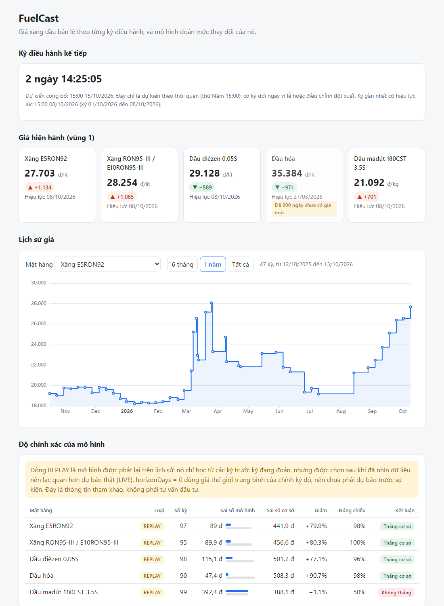

# FuelCast

[](https://github.com/TruongVanHiep/fuelcast/actions/workflows/ci.yml)

Theo dõi và dự báo giá xăng dầu bán lẻ ở Việt Nam theo từng kỳ điều hành giá
(công bố chiều thứ Năm). Dữ liệu lấy từ bản tin của Bộ Công Thương.

Trạng thái dự án: **đang phát triển**. Phần thu thập dữ liệu và API đọc đã chạy;
phần dự báo mới đo được ở mức "giải thích một kỳ", chưa dự báo trước sự kiện.
Xem mục *Điều gì đã được chứng minh, và điều gì chưa*.



*Dashboard ở `/`: đếm ngược tới kỳ công bố dự kiến, giá hiện hành, lịch sử giá và
bảng điểm của mô hình. Lời cảnh báo REPLAY nằm ngay trên bảng điểm.*

## Đã có

| Phần | Nội dung |
|---|---|
| Thu thập | Quét danh sách tin moit.gov.vn, tải từng bản tin, **lưu HTML gốc**, bóc giá bán lẻ và giá thế giới |
| Lưu trữ | PostgreSQL + TimescaleDB, schema do Flyway quản lý, nạp lại không nhân đôi (khoá tự nhiên) |
| API đọc | `GET /api/v1/prices/current`, `/prices/history`, `/cycles/current`, `/accuracy/scorecard` |
| Lập lịch | Tự đi hỏi MOIT xem có bản tin mới và nạp nó (mặc định tắt, xem mục *Chạy*) |
| Mô hình | Truyền dẫn giá thế giới → giá bán lẻ, đánh giá walk-forward so với "giá không đổi" |
| Dự báo LIVE | Dự báo cho kỳ tới được tạo **trước** bản tin, tự chấm điểm khi bản tin ra (`/forecasts/next`) |
| Lỗi | Theo RFC 7807 (`application/problem+json`) |

## Chạy

Cần JDK 21 và Docker.

```bash
cd fuelcast-core
docker compose up -d            # cả hệ thống: DB + ứng dụng, dashboard ở http://localhost:8080
```

Ứng dụng trong compose chạy với bộ quét **bật**, tự nạp bản tin mới và chấm dự báo. Lần
đầu build image mất vài phút (tải thư viện Maven), các lần sau dùng cache.

Khi phát triển, chỉ dựng DB rồi chạy ứng dụng từ IDE hoặc dòng lệnh (tránh tranh cổng 8080):

```bash
docker compose up -d postgres   # chỉ TimescaleDB, cổng 5433 trên máy
./mvnw spring-boot:run          # dashboard ở http://localhost:8080, API ở /api/v1
./mvnw test
```

Dashboard là một trang tĩnh (`src/main/resources/static/index.html`) do chính Spring
phục vụ; biểu đồ nạp thư viện ECharts từ CDN nên cần có mạng để vẽ.

Cơ sở dữ liệu dùng cổng **5433** (không phải 5432) để không đụng PostgreSQL cài sẵn.

**Tự động nạp bản tin mới.** Mặc định tắt, để test và các lệnh chạy một lần không lén
gọi mạng. Bật khi triển khai bằng `--fuelcast.ingestion.poll.enabled=true`. Hai nhịp:
mỗi 10 phút trong khung thứ Năm 14:45 đến 17:00 (giờ Việt Nam), thưa hơn (6 giờ) ngoài
khung để bắt kỳ bị dời ngày. Chỉ an toàn khi chạy một bản ứng dụng.

Các việc chạy bằng dòng lệnh (thêm `--spring.main.web-application-type=none` để app tự thoát):

| Tham số | Việc làm |
|---|---|
| `--fuelcast.backfill.since=2024-01-01` | Quét và nạp các bản tin từ ngày đó (mất cỡ 20 phút, cách nhau 5 giây/request) |
| `--fuelcast.reprocess=true` | Parse lại bản gốc đã lưu, không gọi mạng |
| `--fuelcast.backtest=true` | In bảng đo độ chính xác |
| `--fuelcast.forecast.replay=true` | Lưu các dự báo phát lại vào bảng `forecast` |

## Kiến trúc

Một ứng dụng Spring Boot theo kiểu modular monolith, các lớp tách rõ:

```
moit.gov.vn ─ scraper ─ parser ─ ingestion ─► PostgreSQL ◄─ service ◄─ controller ─► JSON
                          │                      ▲
              ingestion_run.raw_payload ─────────┘ (parse lại khi sửa parser)
```

Vài quyết định có chủ ý:

- **Lưu HTML gốc trước khi parse.** Trang nguồn đổi bố cục vài lần mỗi năm; có bản
  gốc thì sửa parser xong là sửa được lịch sử trong vài giây, không phải quét lại.
- **Không dùng message broker.** Các module chạy chung một tiến trình; đặt broker
  vào giữa chỉ thêm chi phí vận hành mà không mua được gì. Sẽ xem lại khi tách
  service thông báo ra khỏi tiến trình chính.
- **Lọc bản tin theo tiêu đề, không theo URL.** Đường dẫn bản tin không nhất quán
  (lúc có năm, lúc không, có bản tên `dgsg.html`).
- **Thời điểm trả về theo giờ Việt Nam (`+07:00`).** Mặc định UTC làm kỳ nửa đêm
  27/3 hiện thành 26/3.

## Điều gì đã được chứng minh, và điều gì chưa

Mô hình đoán mức thay đổi giá bán lẻ (đồng/lít) từ mức thay đổi **giá thế giới
trung bình của chính kỳ đó**, học theo kiểu walk-forward (mỗi kỳ chỉ dùng các kỳ
trước). So với đoán "giá không đổi":

| Mặt hàng | Số kỳ | Sai số TB mô hình | Sai số TB "không đổi" | Đúng chiều |
|---|---|---|---|---|
| RON95 | 95 | 90 | 457 | 100% |
| E5RON92 | 97 | 89 | 442 | 98% |
| Dầu điêzen | 98 | 115 | 502 | 96% |
| Dầu hỏa | 90 | 47 | 508 | 98% |
| Dầu madút | 99 | 392 | 388 | 49% |

**Đọc con số này cho đúng:**

- **Đây là "giải thích", chưa phải "dự báo".** Giá thế giới trung bình của kỳ chỉ
  đầy đủ vào lúc công bố, nên mô hình đang ở *horizon 0*. Dự báo trước sự kiện cần
  số liệu theo ngày (tỷ giá, giá futures) mà dự án chưa thu thập.
- **Dự báo THẬT, trước sự kiện, hiện chưa hơn việc đoán "giá không đổi".** Mô hình chỉ
  dùng thông tin có trước giờ công bố (giá thế giới của kỳ vừa rồi) cho sai số 449 đến
  506 đồng (bốn mặt hàng, không kể madút), so với 447 đến 514 của "không đổi", và đúng
  chiều khoảng 50% (tung đồng xu). Toàn bộ kỹ năng ở bảng trên đến từ giá thế giới của *chính kỳ đó*, thứ không ai
  biết trước. Muốn dự báo thật cần số liệu theo ngày (tỷ giá, giá futures). Hệ thống
  vẫn ghi dự báo `LIVE` mỗi kỳ và chấm điểm, để có bằng chứng ngoài mẫu từ nay.
- **Các dòng trong bảng `forecast` hiện đều là `REPLAY`**, tức phát lại trên lịch
  sử. Mô hình được chọn sau khi đã nhìn dữ liệu nên kết quả lạc quan hơn dự báo
  thật. API bảng điểm tách `REPLAY` khỏi `LIVE` và luôn kèm lời cảnh báo.
- **Dầu madút không dự báo được** (không thắng đường cơ sở). Hệ thống báo thẳng
  điều đó thay vì giấu.
- **Giá thế giới trong dữ liệu là trung bình theo kỳ**, không phải giá đóng cửa
  hằng ngày: nguồn miễn phí duy nhất có sẵn. Không dùng lẫn với giá theo ngày.
- **Có kỳ bị thiếu bản tin, và không tìm lại được.** Kiểm tra liên tục (mức đổi trong
  bản tin phải bằng chênh lệch giá) phát hiện hai chỗ đứt (25/3/2026, 2/7/2026): giá có
  đổi ở giữa nhưng MOIT không đăng bản tin nào trên mục tin. Chúng bị loại khỏi phần
  đánh giá. Chi tiết ở [docs/data-sources.md](docs/data-sources.md). Bản tin 26/6/2025
  dùng bảng số với hai mốc giá nên parser chưa đọc được.
- Mẫu nhỏ (khoảng 140 kỳ), đừng suy ra quá nhiều từ một vài chữ số.

Thông tin chỉ mang tính tham khảo, không phải tư vấn đầu tư.

## Bài toán khó nhất tôi gặp

**Mô hình của tôi đạt 98% đúng chiều, và con số đó gần như vô nghĩa.**

Tôi dựng mô hình đoán mức đổi giá bán lẻ từ mức đổi giá thế giới, đánh giá walk-forward
(mỗi kỳ chỉ học từ các kỳ trước). Kết quả trông rất tốt: sai số 47 đến 115 đồng so với 442
đến 508 của việc đoán "giá không đổi", đúng chiều 96 đến 100%. Không có leakage, đã có test
chặn. Vậy mà nó không phải dự báo.

Cái bẫy nằm ở chỗ đầu vào. Giá thế giới tôi dùng là **trung bình của chính kỳ đang được
đoán**, thứ chỉ đầy đủ vào lúc bản tin ra. Mô hình giải thích một kỳ đã biết, không đoán
trước một kỳ chưa tới. Khi tôi đo lại chỉ với thông tin có thật *trước* giờ công bố (giá
thế giới của kỳ liền trước), kỹ năng biến mất: sai số ngang "không đổi", đúng chiều khoảng
50%.

Cách tôi xử lý, theo thứ tự:

1. **Tách hai loại dự báo ngay trong schema.** Cột `kind` là `REPLAY` (phát lại lịch sử, có
   thể lạc quan) hoặc `LIVE` (ghi trước sự kiện). Bảng điểm không bao giờ trộn hai loại,
   và mọi phản hồi API đều kèm lời cảnh báo.
2. **Dựng đường `LIVE` thật**: dự báo ghi trước bản tin, dấu thời gian trong DB làm chứng,
   tự chấm bằng bản tin đầu tiên sau đó.
3. **Đo cái có thể đạt được.** Thí nghiệm trên lịch sử cho thấy nếu có Brent theo ngày một
   cách kịp thời thì dự báo trước 1 đến 3 ngày giảm khoảng 20% sai số và đúng chiều 71 đến
   78%: kỹ năng thật nhưng khiêm tốn, kém xa con số 98%. Nguồn miễn phí hợp lệ (FRED/EIA)
   chậm khoảng 8 ngày, nguồn khác (Stooq) cấm bot, nên tôi chưa đạt được. Chi tiết ở
   [docs/data-sources.md](docs/data-sources.md).

Kết quả `LIVE` đầu tiên (4 dự báo cho kỳ 15/10/2026) đúng như phép đo báo trước: mô hình
thua "không đổi" ở 3 trong 4 mặt hàng và đúng chiều 2 trong 4. Mẫu quá nhỏ để kết luận gì,
nhưng nhất quán, và tôi để nó hiển thị công khai thay vì giấu.

Điều tôi rút ra: một con số đẹp phải được hỏi "đầu vào này có thật sự có trước sự kiện
không". Phần lớn công sức của dự án này là dựng hạ tầng để câu hỏi đó luôn có câu trả lời
trung thực, chứ không phải để làm cho con số đẹp hơn.

## Việc tiếp theo

- Thu thập giá dầu theo ngày, **kịp thời**, để dự báo thật theo `horizon_days`: đây là điều
  kiện để dự báo `LIVE` có kỹ năng thật. Thí nghiệm trên lịch sử cho thấy Brent theo ngày
  giảm khoảng 20% sai số ở 1 đến 3 ngày trước. Nguồn miễn phí hợp lệ (FRED/EIA) chậm
  khoảng 8 ngày, nên chưa dùng được; xem [docs/data-sources.md](docs/data-sources.md).
- Để bộ quét chạy và để bảng điểm `LIVE` tích luỹ qua nhiều kỳ.
- Tìm hai bản tin bị thiếu và hỗ trợ bản tin dạng bảng của 26/6/2025.
